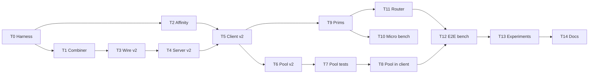

# Client-Side Parallel Hybrid KEX + Precomputed Key Pool: Implementation Plan

> **For agentic workers:** REQUIRED SUB-SKILL: Use superpowers:subagent-driven-development (recommended) or superpowers:executing-plans to implement this plan task-by-task. Steps use checkbox (`- [ ]`) syntax for tracking.

**Goal:** Show, with a correct protocol and sound measurements, that running the classical and PQC halves of a hybrid key exchange in parallel on the **client** reduces handshake latency, especially for FrodoKEM-1344 and BIKE-L5. Include a key pool that precomputes **both** the EC and the KEM keys for the ClientHello, and an adaptive switch that picks sequential or parallel per handshake from measured costs and current CPU load.

**Architecture:** The wire flow is reshaped to match TLS 1.3. The client sends its EC and KEM public keys in ClientHello. The server, which always runs sequentially, does the ECDH and encapsulates, then returns its EC key and the ciphertext in ServerHello. The client derives the ECDH secret and decapsulates. The client's critical path has two phases that can each be parallelized:
- **Phase A (before ClientHello):** EC keygen ‖ KEM keygen. The pool skips this phase entirely when it has a key ready.
- **Phase B (after ServerHello):** ECDH derive ‖ KEM decaps.

The router decides separately for each phase, using a pure function over measured costs.

**Tech Stack:** C11, pthreads, OpenSSL ≥ 3.0, liboqs, Linux (needed for `pthread_setaffinity_np` and `/proc/pressure`), Python 3 with numpy/scipy/matplotlib for analysis.

**Spec:** This conversation's review ([code_review.md](file:///Users/pranav/.gemini/antigravity-cli/brain/d19404d1-2cb5-4116-839a-051589d2b08d/code_review.md)) and Gómez-Cambronero et al., arXiv:2603.11006v2, §4.3 and §4.8.

## Global Constraints

- Base branch: `feat/precomputed-keypool` (`f07be65`). Do all work on a new branch, `feat/client-parallel-v2`.
- Scope is **client-side only**. The server is sequential on purpose; say so in the README and the paper.
- Suites in scope: combo IDs `1` (X25519+ML-KEM-768, the control case), `3` (P-384+ML-KEM-1024), `9` (P-384+FrodoKEM-1344-AES), `10` (P-384+BIKE-L5).
- Never hard-code KEM sizes. Always use `kem->length_public_key`, `length_ciphertext`, `length_secret_key` and `length_shared_secret`. For reference, FrodoKEM-1344 has a pk ≈ 21.5 KB, so wire length fields for KEM data must be `uint32_t`.
- Every key share is **used exactly once**. KEM secret keys are freed with `OQS_MEM_secure_free`, and EC keys with `EVP_PKEY_free`.
- No code path may leave a thread's CPU affinity changed after it returns.
- Every published number must trace back to a raw CSV committed under `results/<date>-<host>/`.
- Paper wording: write "ClientHello construction cost", not "keygen is the dominant cost". The cited paper does not break the overhead down by primitive.

## Review Focus

1. **The pool runs dry during a burst.** If 64 back-to-back handshakes hit a pool with capacity 32, each extra handshake must fall back to inline keygen, count as a miss, and still succeed. Tested in Task 7 (`test_pool_drain_fallback`).
2. **Malformed or mismatched lengths in ClientHello or ServerHello.** If `pqc_pk_len != kem->length_public_key`, or a message is truncated, the server or client must reject the handshake and must not read out of bounds. Tested in Task 4 (`test_server_rejects_bad_pk_len`) and Task 5.
3. **One half of the hybrid fails.** If ECDH fails, or decaps produces a shared secret that doesn't match the server's, the handshake must fail, with no session key derived from only one secret. Tested in Task 1 and Task 5 (key confirmation).
4. **Single-core or pinned clients** (`taskset -c 0`). The router must choose sequential and must never wait on a worker that can't run. Tested in Task 11 (`test_route_single_core`).
5. **Two threads call the engine at once.** With a single worker, the second caller must fall back to sequential rather than deadlock or corrupt shared state. Tested in Task 2 (`test_engine_busy_fallback`).

---

## Phase 0: Setup

### Task 0: Branch, build and test harness

**Files:**
- Modify: `c_dispatch/Makefile` (add a `test` target that builds and runs every `test_*.c`)
- Create: `c_dispatch/tests/test_util.h` (a `CHECK(cond, msg)` macro that prints `PASS`/`FAIL` and counts failures; `main` returns the non-zero failure count)

- [ ] **Step 1:** `git checkout feat/precomputed-keypool && git checkout -b feat/client-parallel-v2`
- [ ] **Step 2:** Move `test_key_pool.c` to `c_dispatch/tests/` and convert it to `test_util.h`.
- [ ] **Step 3:** Add `make test` (runs every `tests/test_*` binary) and `make test-asan` (`-fsanitize=address,undefined`) and `make test-tsan` (`-fsanitize=thread`).
- [ ] **Step 4:** Run `make test`. Expected: the existing key pool test passes.
- [ ] **Step 5:** Commit: `chore: add C test harness and sanitizer targets`

---

## Phase 1: Correctness fixes

### Task 1: Fail-closed hybrid combiner

**Files:**
- Modify: `c_dispatch/include/crypto_engine.h`, `c_dispatch/src/crypto_engine.c`
- Test: `c_dispatch/tests/test_combiner.c`

**Interfaces:**
- Produces: `int hybrid_derive_session_key(const AlgoCombo *combo, const char *kdf_type, const uint8_t *ecdh_ss, size_t ecdh_len, const uint8_t *kem_ss, size_t kem_len, uint8_t out[32]);` It returns `-1` if the combo is hybrid and either length is 0. The IKM is `kem_ss || ecdh_ss`, KEM first as in RFC 10024 `X25519MLKEM768`. Document the order.
- Produces: `int crypto_key_confirm_tag(const uint8_t key[32], const char *label, uint8_t tag[32]);` This is HMAC-SHA256(key, label).

- [ ] **Step 1: Write the failing tests**
  - `test_combiner_rejects_missing_kem`: hybrid combo 9, `kem_len = 0` → returns `-1`.
  - `test_combiner_rejects_missing_ecdh`: `ecdh_len = 0` → `-1`.
  - `test_combiner_deterministic`: the same inputs twice give identical output. Swapping the two inputs gives a different output.
  - `test_confirm_tag_differs_by_label`: the tags for `"client finished"` and `"server finished"` differ.
- [ ] **Step 2:** Run `make test`. Expected: link error, because the functions don't exist yet.
- [ ] **Step 3:** Implement both functions, reusing the existing `crypto_hkdf_sha256` and `crypto_blake3_kdf`.
- [ ] **Step 4:** Run `make test`. Expected: PASS.
- [ ] **Step 5:** Commit: `fix(crypto): fail-closed hybrid combiner and key-confirmation tag`

### Task 2: Affinity hygiene and a busy-safe engine

**Files:**
- Create: `c_dispatch/include/affinity.h`, `c_dispatch/src/affinity.c`
- Modify: `c_dispatch/src/engine.c` (the pinning at L379–386 and L426–434), `c_dispatch/src/telemetry.c` (`calibrate_inter_thread_sync`), `c_dispatch/client.c` (pinning in the parallel branch)
- Test: `c_dispatch/tests/test_affinity.c`

**Interfaces:**
- Produces: `typedef struct { cpu_set_t saved; int active; } AffinityScope;`, plus `int affinity_pin_scope(AffinityScope *s, int cpu);` and `void affinity_restore(AffinityScope *s);`
- Produces: `int engine_pick_cpus(int *main_cpu, int *worker_cpu);` It parses `/sys/devices/system/cpu/cpu*/topology/thread_siblings_list` and returns two CPUs on **different physical cores**, avoiding CPU 0 when there are ≥ 4 CPUs. It returns `-1` if there are fewer than 2 physical cores.
- Changes: `execute_parallel_optimized` uses `pthread_mutex_trylock` on a new `g_dispatch_lock`. If the lock is busy, it runs `execute_sequential` and sets `result->fell_back = 1`. Add `int fell_back;` to `SharedCryptoResult`.

- [ ] **Step 1: Write the failing tests**
  - `test_affinity_restored_after_parallel`: record `sched_getaffinity` → run `execute_parallel_optimized` → check the mask is identical.
  - `test_affinity_restored_after_calibration`: the same check around `host_profile_init()`.
  - `test_pick_cpus_distinct_cores`: on hosts with ≥ 2 physical cores, the two returned CPUs have different `core_id`.
  - `test_engine_busy_fallback`: two threads call `execute_parallel_optimized` simultaneously. Both return 0, and at least one has `fell_back == 1`.
- [ ] **Step 2:** Run `make test`. Expected: the affinity tests fail.
- [ ] **Step 3:** Implement the code, then replace every raw `pthread_setaffinity_np` call in the files listed above with a scope and restore pair.
- [ ] **Step 4:** Run `make test && make test-tsan`. Expected: PASS, with no TSan reports.
- [ ] **Step 5:** Commit: `fix(engine): scoped affinity, SMT-aware core pick, busy fallback`

---

## Phase 2: Wire flow shaped like TLS 1.3

### Task 3: Wire format v2

**Files:**
- Modify: `c_dispatch/include/network_utils.h` (L66–94)

**Interfaces (Produces):**
```c
#define WIRE_MAGIC_V2 0x544C5332U   /* 'TLS2' – old clients are rejected */
typedef enum { WIRE_MSG_CLIENT_HELLO=0x11, WIRE_MSG_SERVER_HELLO=0x12,
               WIRE_MSG_SERVER_FINISHED=0x14 } WireMsgTypeV2;
typedef struct __attribute__((packed)) {
    uint8_t kdf_type; uint8_t reserved; uint16_t c_pub_len; uint32_t pqc_pk_len;
} ClientHelloMetaV2;            /* followed by c_pub || pqc_pk */
typedef struct __attribute__((packed)) {
    uint16_t srv_pub_len; uint16_t reserved; uint32_t pqc_ct_len;
} ServerHelloMetaV2;            /* followed by srv_pub || pqc_ct */
/* ServerFinished payload = 32-byte confirm tag ("server finished") */
```
All multi-byte fields are in network byte order. Note that the current code sends `c_pub_len` in host order, which is a bug. Remove `WIRE_MSG_PQC_CIPHERTEXT` and the `dispatch_mode` field, because the server no longer dispatches.

- [ ] **Step 1:** Add the v2 definitions and delete the v1 binary structs.
- [ ] **Step 2:** Delete the legacy JSON handshake path from `c_dispatch/server.c` (`handle_client`'s cJSON branch) and `c_dispatch/client.c`. Keep the copy in `c/` as the legacy framework.
- [ ] **Step 3:** Run `make all`. Expected: compile errors only in `server.c`, `client.c` and `bench_e2e.c`. Tasks 4 and 5 fix them.
- [ ] **Step 4:** Commit: `refactor(wire): v2 framing — KEM pk in ClientHello, ct in ServerHello`

### Task 4: Server v2 (sequential, encapsulates)

**Files:**
- Modify: `c_dispatch/server.c` (rewrite `handle_client_binary`, and delete `pqc_keygen_worker`, `DispatchMode` and the hard-coded `route`)
- Test: `c_dispatch/tests/test_server_proto.c` (runs the server in-process on an ephemeral port and acts as a raw client)

**Interfaces:**
- Produces: `int server_handle_v2(int fd);` It returns 0 on success and −1 on any protocol or crypto failure. On failure it closes the connection without sending ServerFinished.
- Flow:
  1. Read the header and `ClientHelloMetaV2`.
  2. Check `c_pub_len ≤ 300`, and check `pqc_pk_len == kem->length_public_key`.
  3. Read `c_pub || pqc_pk`.
  4. EC keygen, then derive.
  5. `OQS_KEM_encaps(ct, ss, pqc_pk)`.
  6. Send `ServerHelloMetaV2 || srv_pub || ct`.
  7. Call `hybrid_derive_session_key`, then send ServerFinished with the tag.

- [ ] **Step 1: Write the failing tests**
  - `test_server_happy_path_combo9`: the raw client sends a valid CH and gets back a SH whose `pqc_ct_len == kem->length_ciphertext`. Decapsulating with the client's sk and combining gives a confirm tag equal to ServerFinished.
  - `test_server_rejects_bad_pk_len`: `pqc_pk_len = real − 1` → the connection closes and no SH is sent.
  - `test_server_rejects_truncated_ch`: the client sends half the payload and closes → the server returns −1 without crashing (run under ASan).
  - `test_server_rejects_oversized_c_pub`: `c_pub_len = 4000` → rejected.
- [ ] **Step 2:** Run `make test`. Expected: FAIL.
- [ ] **Step 3:** Implement the server flow.
- [ ] **Step 4:** Run `make test && make test-asan`. Expected: PASS.
- [ ] **Step 5:** Commit: `feat(server): TLS1.3-shaped v2 handshake, server encapsulates, sequential by design`

### Task 5: Client v2 with a two-phase critical path

**Files:**
- Modify: `c_dispatch/client.c` (rewrite `execute_dispatch_handshake`, delete `client_pqc_encaps_worker` and its pool)
- Modify: `c_dispatch/include/engine.h`, `c_dispatch/src/engine.c` (replace the role-based API)
- Test: `c_dispatch/tests/test_client_proto.c`

**Interfaces:**
- Produces in `engine.h`. These replace `execute_sequential` and `execute_parallel_optimized` and `HandshakeRole`:
  ```c
  typedef struct { EVP_PKEY *ec_priv; uint8_t ec_pub[300]; size_t ec_pub_len;
                   uint8_t *kem_pk; uint8_t *kem_sk; size_t kem_pk_len, kem_sk_len; } ClientKeyShare;
  void client_key_share_free(ClientKeyShare *ks);      /* OQS_MEM_secure_free(sk) */
  int  engine_client_keygen(const AlgoCombo *c, DispatchRoute r, ClientKeyShare *out, int *fell_back);   /* Phase A */
  int  engine_client_finish(const AlgoCombo *c, DispatchRoute r, const ClientKeyShare *ks,
                            const uint8_t *srv_pub, size_t srv_pub_len,
                            const uint8_t *ct, size_t ct_len,
                            SharedCryptoResult *out);                                               /* Phase B */
  ```
- Produces in `client.c`:
  ```c
  typedef struct { double ch_prep_ms, post_sh_ms, total_ms; int pool_hit;
                   DispatchRoute route_a, route_b; int fell_back; int ok; } HandshakeTiming;
  int client_handshake_v2(const char *host, const AlgoCombo *c, const char *kdf,
                          RouteOverride ov, HandshakeTiming *t);
  typedef enum { ROUTE_OV_AUTO, ROUTE_OV_SEQ, ROUTE_OV_PAR } RouteOverride;
  ```
- Timing boundaries:
  - `ch_prep_ms` runs from just after `connect` until the ClientHello `send_all` returns.
  - `post_sh_ms` runs from when the ServerHello has been fully received until the session key is derived.
  - `total_ms` runs from just after `connect` until ServerFinished is verified.
- The client returns `ok = 0` if the ServerFinished tag doesn't match its own tag (`CRYPTO_memcmp`).

- [ ] **Step 1: Write the failing tests**
  - `test_keygen_seq_par_equivalent`: for combo 10, both routes produce a share with `kem_pk_len == kem->length_public_key` and a valid EC key.
  - `test_finish_seq_par_same_secret`: given a fixed server response, which the test builds by encapsulating against the share's pk, both routes produce identical `SharedCryptoResult` secrets.
  - `test_client_e2e_all_suites`: for each of combos {1, 3, 9, 10} and each override in {SEQ, PAR}, `client_handshake_v2` against the in-process server returns `ok == 1`.
  - `test_client_detects_bad_confirm`: a test server that sends a wrong tag → `ok == 0`.
  - `test_key_share_wiped`: under ASan, `client_key_share_free` causes no leak, and it accepts a share whose `kem_sk` is already NULL.
- [ ] **Step 2:** Run `make test`. Expected: FAIL.
- [ ] **Step 3:** Implement the engine functions and the client. The worker job struct now carries a function pointer and an argument, so one persistent worker handles both phases.
- [ ] **Step 4:** Run `make test && make test-asan && make test-tsan`. Expected: PASS.
- [ ] **Step 5:** Commit: `feat(client): v2 handshake with parallelizable keygen and finish phases`

---

## Phase 3: Key pool v2 (EC and KEM)

### Task 6: Rework the pool to store full key shares

**Files:**
- Modify: `c_dispatch/include/key_pool.h`, `c_dispatch/src/key_pool.c`

**Interfaces (Produces, replacing the current API):**
```c
typedef struct { unsigned long hits, misses, replenished; double refill_ms_total; size_t available, capacity; } KeyPoolStats;
int  key_pool_init(const AlgoCombo *const *combos, int n_combos, size_t capacity, int refill_cpu); /* refill_cpu = -1 → unpinned */
int  key_pool_pop(const AlgoCombo *c, ClientKeyShare *out, int *hit);  /* miss → inline engine_client_keygen(SEQ) */
void key_pool_get_stats(const AlgoCombo *c, KeyPoolStats *out);
void key_pool_reset_stats(void);
void key_pool_destroy(void);   /* secure-frees every remaining slot */
```
Design decisions:
- One ring **per active combo** (the curve and KEM pair), not per curve. Only the combos passed to `init` get refilled.
- A slot holds a `ClientKeyShare`. On pop, ownership moves to the caller and the slot's pointers are set to NULL.
- Refill is triggered when the count drops below the low-water mark (`capacity/2`) and continues until the ring is full. The refill thread is pinned to `refill_cpu` using the Task 2 helpers. The default in benchmarks is a CPU outside `{main_cpu, worker_cpu}`, or unpinned with a warning if no such CPU exists.
- `refill_ms_total` adds up the wall time spent generating keys in the background. This is the amortized cost you report.
- The stats counters are `_Atomic unsigned long`.
- Fix the misleading "wipe to guarantee PFS" comment: forward secrecy comes from using each key once and secure-freeing the secret keys.

- [ ] **Step 1:** Rewrite the header and implementation following the design above.
- [ ] **Step 2:** Run `make all`. Expected: compiles. The tests are written in Task 7.
- [ ] **Step 3:** Commit: `feat(keypool): store EC+KEM key shares per active suite, hit/miss stats, pinned refill`

### Task 7: Key pool tests

**Files:**
- Modify: `c_dispatch/tests/test_key_pool.c` (replace the old EC-only tests)

- [ ] **Step 1: Write the tests**
  - `test_pool_single_use`: pop `capacity × 3` shares from combo 10 while refilling. No two `kem_pk` values are equal (`memcmp`), and no two EC public keys are equal.
  - `test_pool_hit_counting`: init with capacity 8, wait until full (poll `available == 8`, 5 s timeout), pop 8 → `hits == 8 && misses == 0`.
  - `test_pool_drain_fallback`: capacity 4, refill disabled for the test via `refill_cpu = -2`, a test-only flag that means "don't start the refill thread". Pop 10 → all succeed, `hits == 4`, `misses == 6`.
  - `test_pool_share_valid`: a popped share completes a full `client_handshake_v2` against the in-process server, so `ok == 1`.
  - `test_pool_only_active_suites`: init with combo 9 only. `key_pool_get_stats(combo 1)` returns `capacity == 0`.
  - `test_pool_concurrent_pop`: 4 threads × 50 pops on combo 1. No crashes, `hits + misses == 200`. Run under TSan.
  - `test_pool_destroy_no_leak`: init, fill, destroy. ASan reports no leaks.
- [ ] **Step 2:** Run `make test && make test-asan && make test-tsan`. Expected: PASS.
- [ ] **Step 3:** Commit: `test(keypool): single-use, hit/miss, drain fallback, concurrency, leak checks`

### Task 8: Use the pool in the client handshake

**Files:**
- Modify: `c_dispatch/client.c` (Phase A in `client_handshake_v2`)

- [ ] **Step 1: Write the failing test.** `test_client_pool_hit_skips_phase_a`: with the pool enabled and full, `t.pool_hit == 1` and `t.ch_prep_ms` is under 20% of the median `ch_prep_ms` with the pool disabled, measured over 50 runs on combo 9.
- [ ] **Step 2:** Run `make test`. Expected: FAIL.
- [ ] **Step 3:** In Phase A: if the pool is enabled, call `key_pool_pop` and set `t->pool_hit`. On a miss, `key_pool_pop` has already generated the keys inline. Record `route_a` as `ROUTE_SEQUENTIAL` on a miss **only if** inline generation used SEQ. Better still, have a miss call `engine_client_keygen` with the router's Phase A decision (Task 11), so that an empty pool can still parallelize.
- [ ] **Step 4:** Run `make test`. Expected: PASS.
- [ ] **Step 5:** Commit: `feat(client): pop full key shares from pool, record pool_hit`

---

## Phase 4: Correct microbenchmarks

### Task 9: Per-primitive costs (`bench_prims`)

**Files:**
- Modify: `c_dispatch/bench_prims.c` (rewrite it. It currently times keygen, keygen and derive together, and keygen, encaps and decaps together)

**Interfaces:**
- Produces: `prims.json` with one record per (algorithm, op): `{alg, op ∈ {keygen, derive, encaps, decaps}, n, median_us, p95_us, mad_us}`.
- Produces: `int prims_measure(const char *alg_or_curve, PrimOp op, int n, double *median_us);` in `c_dispatch/src/prims.c`, so Task 11 can reuse it for calibration at startup.

- [ ] **Step 1:** Implement it. Use 20 warm-up iterations and then `n = 500` timed iterations of **each operation separately**. The derive input comes from a peer key generated outside the timed region.
- [ ] **Step 2:** Run `./bench_prims > prims.json`. Expected: 4 curves/algorithms × the applicable operations, all with `median_us > 0`.
- [ ] **Step 3:** Commit: `feat(bench): isolated per-primitive timing with medians`

### Task 10: Client-role microbenchmark (`benchmark_suite`)

**Files:**
- Modify: `c_dispatch/benchmark_suite.c` (rewrite `run_bench` and remove `ROLE_SERVER`)

Design decisions:
- Benchmark **Phase A** (keygen) and **Phase B** (finish) separately, plus A+B combined.
- Phase B inputs: before each iteration, build a fresh share and a server response outside the timed region.
- **Interleave modes:** each iteration picks SEQ, PAR or AUTO from a shuffled block of 3, using a seeded `rand_r`, and the seed is logged.
- Warm-up: 50 iterations per suite, discarded.
- Output `micro_raw.csv` with columns `suite,phase,mode,iter,ns,route_taken,fell_back`, and nothing else. Statistics are computed in Python (Task 13).
- Also print the theoretical bound from `prims.json`: Phase A `min(T_ec_keygen, T_kem_keygen)` and Phase B `min(T_derive, T_decaps)`.

- [ ] **Step 1:** Implement it.
- [ ] **Step 2:** Run `./benchmark_suite --iters 1000 --seed 42`. Expected: 4 suites × 3 phases × 3 modes × 1000 rows, plus 1 header row.
- [ ] **Step 3:** Check that for combos 9 and 10 the measured PAR saving is ≤ the theoretical bound plus 5% noise. If it's larger, something is wrong with the harness.
- [ ] **Step 4:** Commit: `fix(bench): client-role two-phase microbenchmark with interleaved modes and raw CSV`

---

## Phase 5: Dynamic adaptive switch

### Task 11: A router built on a cost model

**Files:**
- Create: `c_dispatch/include/cost_model.h`, `c_dispatch/src/cost_model.c`
- Modify: `c_dispatch/src/dispatcher.c` (replace Rules 3–6), `c_dispatch/src/telemetry.c` (replace `getloadavg`), `c_dispatch/include/dispatcher.h`
- Test: `c_dispatch/tests/test_router.c`

**Interfaces:**
```c
typedef enum { PHASE_KEYGEN, PHASE_FINISH } HsPhase;
typedef struct {
    double t_classical_us, t_pqc_us;   /* EWMA of the two halves for this suite+phase */
    double t_sync_us;                  /* median calibrated hand-off cost */
    int    usable_physical_cores;      /* from sched_getaffinity + topology */
    double cpu_pressure;               /* PSI some avg10 / 100, or 1 - idle fraction */
    int    worker_busy;
    double margin_us;                  /* default 20.0 */
} RouteInputs;
DispatchRoute route_decide(const RouteInputs *in);              /* PURE function */
DispatchRoute adaptive_dispatch_phase(const AlgoCombo *c, HsPhase p);  /* gathers inputs, applies hysteresis + exploration */
void cost_model_observe(const AlgoCombo *c, HsPhase p, double t_classical_us, double t_pqc_us); /* EWMA α = 0.1 */
int  cost_model_init(const AlgoCombo *const *combos, int n);   /* seeds EWMA via prims_measure(n=30) */
```
Decision rule for `route_decide`, applied in order:
1. `usable_physical_cores < 2` → SEQ
2. `worker_busy` → SEQ
3. `cpu_pressure > 0.5` → SEQ
4. `min(t_classical_us, t_pqc_us) − t_sync_us > margin_us` → PAR
5. otherwise SEQ

In `adaptive_dispatch_phase`:
- **Hysteresis:** switch only if the new decision repeats for 8 consecutive calls.
- **Exploration:** 5% of calls take the other route, so the EWMA for both routes stays fresh. The seeded RNG is logged.
- All shared state is behind one mutex.
- After each handshake, the engine reports how long each half took, measured inside the worker and main thread, through `cost_model_observe`.

Load signal: read `/proc/pressure/cpu` (`some avg10=`). If that's missing, use the busy fraction between two `/proc/stat` samples taken at least 100 ms apart. Delete `getloadavg` and the fixed 80 µs threshold rule. Sync calibration uses 500 round trips, takes the median, and divides by 2 to get the one-way cost.

- [ ] **Step 1: Write the failing table-driven tests for `route_decide`**
  - `test_route_single_core`: cores = 1, with a large cost gap → SEQ
  - `test_route_frodo_finish_par`: classical 900, pqc 2000, sync 15, cores 4, pressure 0 → PAR
  - `test_route_x25519_keygen_seq`: classical 25, pqc 30, sync 15 → SEQ, because 25 − 15 < 20
  - `test_route_pressure_backoff`: the Frodo inputs with pressure 0.8 → SEQ
  - `test_route_worker_busy`: the Frodo inputs with worker_busy = 1 → SEQ
  - `test_hysteresis`: feed 7 PAR decisions followed by SEQ inputs → the route stays at its previous value
- [ ] **Step 2:** Run `make test`. Expected: FAIL.
- [ ] **Step 3:** Implement it. Delete the hard-coded X25519 rule and the "≥ 2 cores → PAR" rule.
- [ ] **Step 4:** Run `make test && make test-tsan`. Expected: PASS.
- [ ] **Step 5:** Commit: `feat(router): per-phase cost-model routing with PSI load signal, hysteresis, exploration`

### Task 12: Per-handshake routing in `bench_e2e`

**Files:**
- Modify: `c_dispatch/bench_e2e.c` (`run_bench` L134–150 and `main`)

- [ ] **Step 1:** Call `client_handshake_v2` with the override in the loop, so the AUTO mode routes on every handshake.
- [ ] **Step 2:** Add these CLI flags:
  - `--precompute {0,1}`
  - `--pool-cap N` (default 32)
  - `--burst N`: send N handshakes back to back, then idle 200 ms (default 0 = steady)
  - `--seed S`
  - `--out path.csv`
- [ ] **Step 3:** Write raw rows: `suite,mode,pool,iter,ch_prep_ms,post_sh_ms,total_ms,pool_hit,route_a,route_b,fell_back`. Modes are interleaved the same way as in Task 10.
- [ ] **Step 4:** Update `run_e2e.sh` so it:
  - pins the server with `taskset -c <server cpus>`, using CPUs outside the client's
  - records `lscpu`, `lscpu -e`, the CPU governor, the turbo state, `openssl version`, the liboqs version and `git rev-parse HEAD` into `env.txt`
- [ ] **Step 5:** Run `./run_e2e.sh --runs 200 --precompute 1`. Expected: a CSV with `ok` handshakes only, and a nonzero pool hit rate.
- [ ] **Step 6:** Commit: `feat(e2e): per-handshake routing, pool/burst flags, raw CSV, pinned server`

---

## Phase 6: Experiment and analysis

### Task 13: Experiment matrix and analysis script

**Files:**
- Create: `experiments/run_matrix.sh`, `analysis/analyze.py`, `results/README.md`

**Matrix:** run each cell with 1000 handshakes and 5 independent repetitions, restarting the processes between them.

| Factor | Levels |
|---|---|
| Suite | 1 (control), 3, 9, 10 |
| Mode | SEQ, PAR, AUTO (interleaved) |
| Pool | off, on |
| Arrival | steady, burst (`--burst 64`, `--pool-cap 32`) |
| Client CPUs | `taskset` with 1 core, 2 physical cores, all cores |
| Background load | none, `stress-ng --cpu <n-2>` |

**`analysis/analyze.py` outputs:**
- Per cell: the median and p95/p99 of `total_ms`, `ch_prep_ms` and `post_sh_ms`, with **95% bootstrap CIs** (10k resamples).
- The speedup `1 − median(PAR)/median(SEQ)` with a bootstrap CI, and a Mann-Whitney U p-value.
- Pool hit rate, and amortized refill cost per handshake (`refill_ms_total / pops`).
- Measured savings compared with the theoretical bound from `prims.json`.
- How well AUTO matches the best fixed mode in each cell: the share of cells where AUTO's median is within the CI of `min(SEQ, PAR)`. This is the main evidence that the adaptive switch works.
- Figures: a speedup bar chart per suite with CIs; `ch_prep_ms` with the pool off and on, which is your comparison with the paper's ~0.3 → 1.8 ms; and an AUTO route-choice heatmap across CPU configuration × load.

- [ ] **Step 1:** Write `run_matrix.sh`, which loops over the factors and saves `results/<date>-<host>/<cell>.csv` and `env.txt`.
- [ ] **Step 2:** Write `analyze.py` and check it on a small run (`--runs 50`). Expected: tables and figures are generated without errors.
- [ ] **Step 3:** Run the full matrix on the target machine with the governor set to `performance` and turbo disabled.
- [ ] **Step 4:** Commit the raw results, the analysis script and the figures: `exp: full client-side matrix with raw data`

---

## Phase 7: Docs and cleanup

### Task 14: Make the README match the evidence

**Files:**
- Modify: `README.md`
- Delete or archive: `DEFENSE_REPORT.md` → `docs/archive/DEFENSE_REPORT_v1.md`, with a header saying it's superseded
- Modify: `c_dispatch/src/dispatcher.c` (remove the commented-out rule blocks)

- [ ] **Step 1:** Rewrite the claims:
  - Say "TLS 1.3-shaped hybrid key exchange prototype (no record layer or authentication)" instead of "RFC 9954 compliant TLS 1.3".
  - State that the work is client-side only and why: server encapsulation is cheap, and server throughput matters more than per-handshake latency. Cite §4.8.
  - Describe the pool as precomputing both the EC and KEM key shares, cite §4.3, and use "ClientHello construction" wording.
- [ ] **Step 2:** Replace the results table with numbers produced by `analyze.py`, with CIs and a link to the raw CSV directory.
- [ ] **Step 3:** Fix the broken `file:///home/sudoroot/...` links and the directory tree (remove `wire_proto.h` and `algo_config.c`, add `key_pool`, `cost_model`, `affinity` and `tests/`).
- [ ] **Step 4:** Add a "Reproducing" section with the exact commands for Tasks 9, 10, 12 and 13.
- [ ] **Step 5:** Commit: `docs: align README with client-side scope and reproducible results`

---

## Dependency order



Tasks 1 and 2 can run in parallel. After Task 5, the pool work (Tasks 6–8) and the benchmark and router work (Tasks 9–11) can also proceed in parallel.
